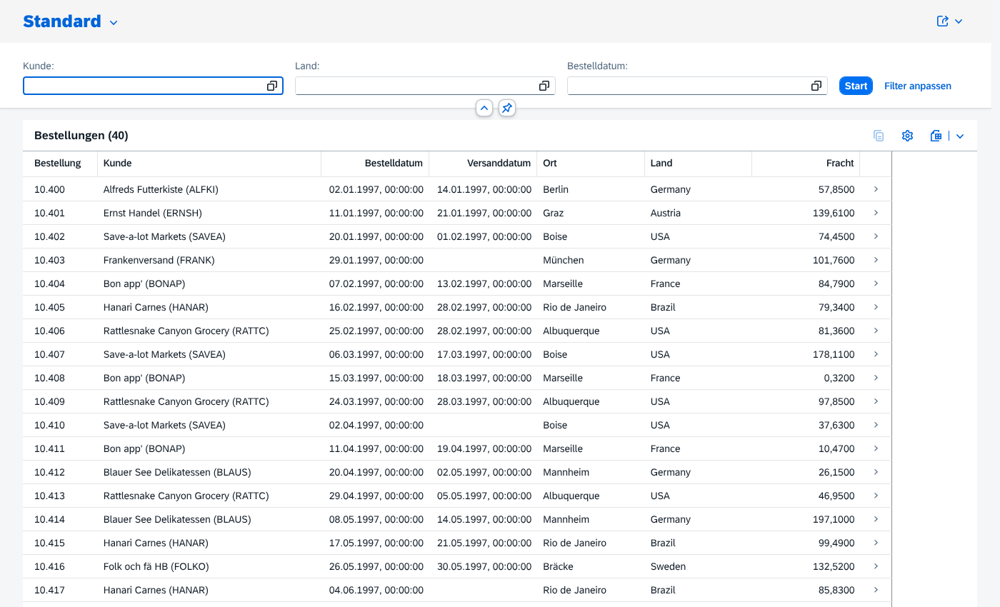
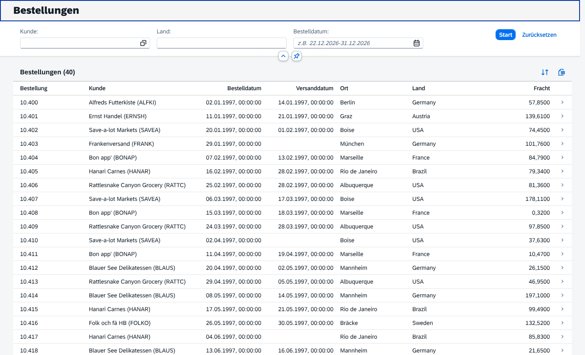
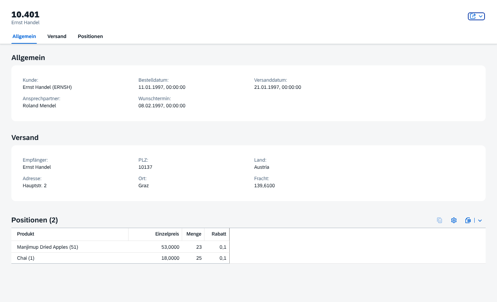
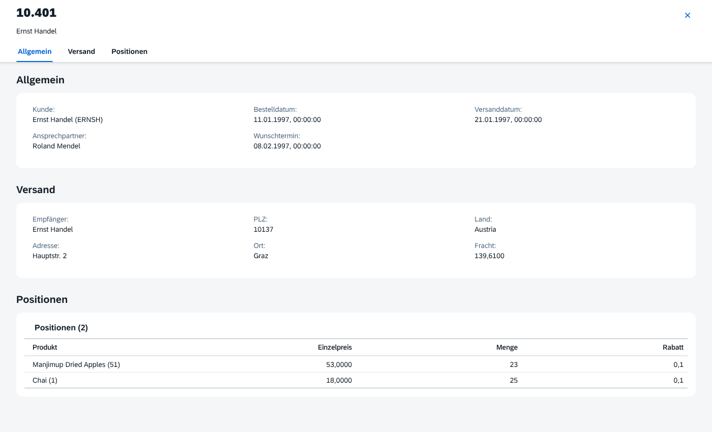
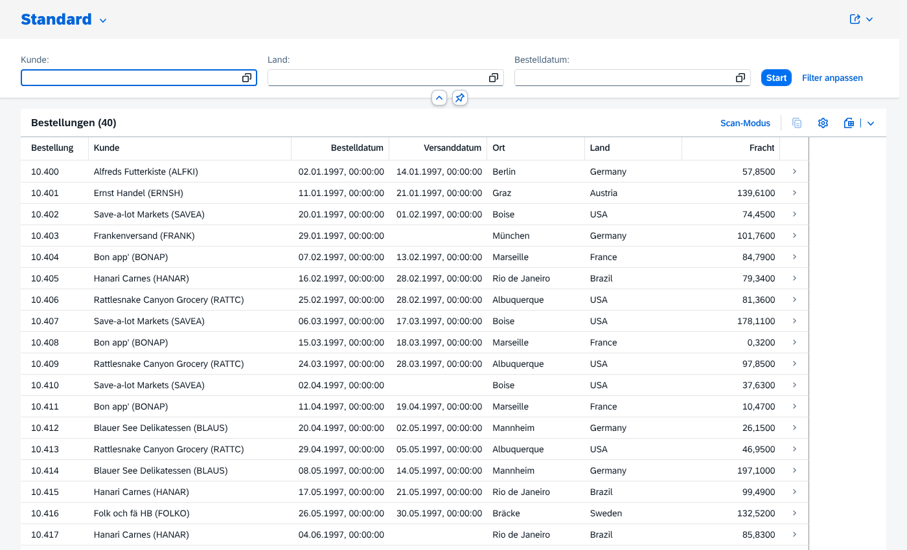
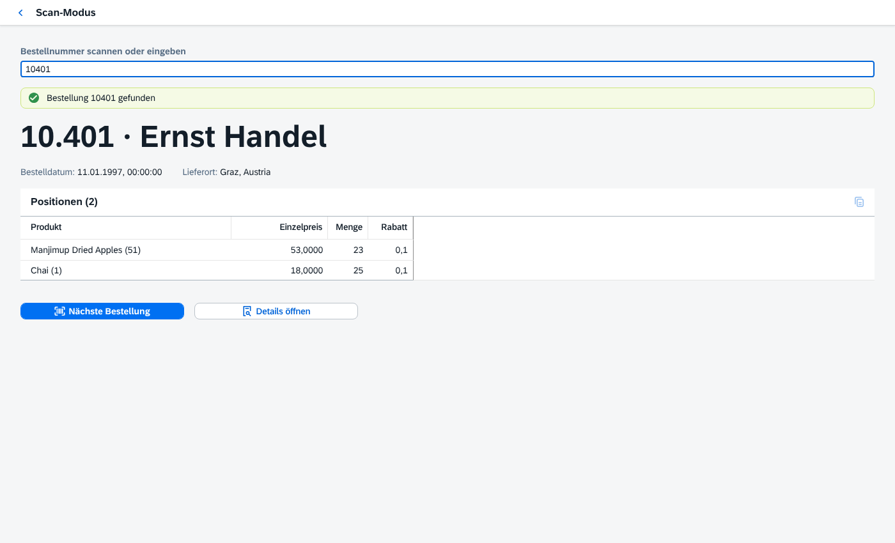

# Fiori ist nicht gleich Fiori

**Eine Anforderung, zwei Umsetzungen: SAP Fiori Elements und SAPUI5 Freestyle – plus eine Kombination aus beiden in einer App**

Beide Apps sehen für den Anwender praktisch gleich aus. Der Unterschied liegt darin, **wie viel selbst gebauter Code** dahintersteckt, und damit darin, was wir **dauerhaft warten, testen und aktualisieren** müssen.

| Fiori Elements | SAPUI5 Freestyle |
|---|---|
|  |  |
|  |  |

---

## Die Anforderung

> „Wir brauchen eine Übersicht über alle Bestellungen. Man soll nach Kunde, Land und Bestelldatum filtern, sortieren und nach Excel exportieren können. Per Klick auf eine Bestellung sieht man Kopfdaten, Versanddaten und die Positionen.“

**Datenquelle:** der öffentliche Northwind-OData-V4-Service (`services.odata.org`), alternativ lokale Mockdaten, falls kein Internet da ist.

---

## Starten (lokal, kein BTP, kein SAP-System)

Voraussetzung ist nur **Node.js** (ab Version 20).

```bash
# Fiori Elements → http://localhost:8080
cd fiori-elements
npm install
npm start              
npm run start-mock

# SAPUI5 Freestyle → in zweitem Terminal, http://localhost:8081
cd freestyle
npm install
npm start -- --port 8081
npm run start-mock -- --port 8081

# Kombiniert (Fiori Elements + Freestyle-Seite in einer App) → drittes Terminal
cd kombiniert
npm install
npm start -- --port 8082
npm run start-mock -- --port 8082
```

> **Windows PowerShell 5:** `&&` funktioniert dort nicht – Befehle einzeln eingeben.

> Tipp für die Präsentation: Vorher einmal `npm install` und `npm start` ausführen (lädt SAPUI5 aus npm). **`start-mock` ist die sichere Variante**, wenn das WLAN im Besprechungsraum unzuverlässig ist.

---

## Die Zahlen (gemessen mit `node compare.mjs`)

| | Fiori Elements | Freestyle | Kombiniert (FE + Scan-Seite) |
|---|---|---|---|
| Annotationen (UI-Beschreibung) | 1 Datei / 235 Zeilen | – | 1 Datei / 235 Zeilen |
| **JavaScript (Controller, Formatter, Component)** | **1 Datei / 8 Zeilen** | **6 Dateien / 246 Zeilen** | **3 Dateien / 85 Zeilen** |
| XML-Views & Fragmente | – | 6 Dateien / 259 Zeilen | 1 Datei / 33 Zeilen |
| i18n-Texte | 1 Datei / 2 Zeilen | 1 Datei / 39 Zeilen | 1 Datei / 15 Zeilen |
| index.html | 1 Datei / 23 Zeilen | 1 Datei / 22 Zeilen | 1 Datei / 23 Zeilen |
| manifest.json | 1 Datei / 107 Zeilen | 1 Datei / 85 Zeilen | 1 Datei / 128 Zeilen |
| **Gesamt** | **5 Dateien / 375 Zeilen** | **15 Dateien / 651 Zeilen** | **8 Dateien / 519 Zeilen** |

So sind die Zahlen zu lesen:

- **Die Zeilenzahl ist nicht der Punkt, sondern die Art der Zeilen.** Die 235 Zeilen bei Fiori Elements sind *deklarativ*: „Zeige Feld X mit Label Y“. Es gibt keine Logik, die kaputtgehen kann. Die 505 Zeilen Views und JavaScript bei Freestyle sind **eigener Programmcode** mit Event-Handlern, Filterlogik, Datumsberechnung, Dialog-Handling und Navigation.
- **Fiori Elements hat 8 Zeilen JavaScript, Freestyle 246.** Jede dieser Zeilen müssen wir testen, reviewen, dokumentieren und bei jedem UI5-Upgrade prüfen.
- Die Annotationen sind hier bewusst als XML geschrieben, weil Northwind ein fremder Service ist. **Bei RAP liegen sie als CDS-Annotationen direkt im Backend** und sind deutlich kompakter. Die UI-Schicht ist dann praktisch leer.

---

## Eine App, mehrere Technologien: `kombiniert/`

Nicht Entweder-oder: Mit dem **Flexible Programming Model (FPM)** kann eine Fiori-Elements-App **eigene Freestyle-Seiten enthalten** – eine App, ein Einstieg, kein Springen über das Launchpad.

| Liste (Fiori Elements) mit Button „Scan-Modus“ | Scan-Seite (Freestyle) in derselben App |
|---|---|
|  |  |

```
Eine App (eine manifest.json, ein Deployment)
├── List Report      ← Fiori Elements (Annotationen)
│     └── Aktion „Scan-Modus“  ← 10 Zeilen JavaScript
├── Object Page      ← Fiori Elements (Annotationen)
└── Scan-Seite       ← Freestyle (eigene View + Controller)
      └── Positionen-Tabelle ← Building Block aus der Annotation UI.LineItem
```

**Ablauf in der Demo:** Liste → „Scan-Modus“ → Bestellnummer scannen (Handheld-Scanner tippt die Nummer und sendet Enter) → Bestellung groß anzeigen → „Nächste Bestellung“ (Fokus springt zurück ins Scan-Feld) oder „Details öffnen“ (zurück in die Fiori-Elements-Detailseite).

Zum Ausprobieren ohne Scanner: Nummer eintippen (z. B. `10401`) und Enter drücken.

**Was man dazu wissen sollte:**
- Freestyle nur dort, wo nötig – Liste und Detail bleiben Fiori Elements. Eigener Code: **85 Zeilen** statt 246.
- Die Positionen-Tabelle auf der Scan-Seite ist ein **Building Block**: Sie kommt aus derselben Annotation wie auf der Detailseite und wird nicht nachprogrammiert.
- Der Freestyle-Teil ist trotzdem eigener Code mit eigener Wartung, und **die ganze App hängt an einer UI5-Version**.
- Die Scan-Seite ist über `#/Scan` direkt aufrufbar – ein Handheld kann also direkt dort starten (eigene Kachel).

---

## Was Fiori Elements „geschenkt“ mitbringt, Freestyle aber nicht

Diese Funktionen hat die Fiori-Elements-App **ohne eine Zeile Code**. In der Freestyle-App fehlen sie, obwohl sie schon mehr Code hat:

| Funktion | Fiori Elements | Freestyle |
|---|---|---|
| Varianten speichern („Meine Sicht“) | ✅ eingebaut | ❌ selbst bauen (Flex/Personalisierung) |
| Spalten ein-/ausblenden, umsortieren | ✅ eingebaut | ❌ selbst bauen |
| Weitere Filterfelder per „Filter anpassen“ | ✅ eingebaut | ❌ selbst bauen |
| Filter mit Operatoren (gleich, enthält, zwischen …) | ✅ eingebaut | ❌ nur das, was programmiert wurde |
| Excel-Export | ✅ eingebaut | ⚠️ 20 Zeilen eigener Code, Spalten doppelt gepflegt |
| Wertehilfe | ✅ 1 Annotation | ⚠️ eigenes Fragment + 3 Event-Handler |
| Sortieren | ✅ eingebaut (auch mehrstufig) | ⚠️ eigener Dialog, nur einstufig |
| Teilen / Als Kachel speichern | ✅ eingebaut | ❌ |
| Barrierefreiheit, Tastaturbedienung | ✅ von SAP getestet | ⚠️ in unserer Verantwortung |
| Neue UX-Features bei UI5-Upgrade | ✅ automatisch | ❌ manuell nachbauen |

---

## Live-Demo: „Bitte noch die Region als Spalte und Filter“

Die eindrucksvollste Stelle der Präsentation ist eine **kleine Änderungsanforderung**: Das Feld `ShipRegion` soll als Spalte, als Filter und auf der Detailseite erscheinen.

### Fiori Elements: 1 Datei, 3 Stellen

In `fiori-elements/webapp/annotations/annotation.xml`:

```xml
<!-- in UI.SelectionFields -->
<PropertyPath>ShipRegion</PropertyPath>

<!-- in UI.LineItem und UI.FieldGroup#Shipping -->
<Record Type="UI.DataField"><PropertyValue Property="Value" Path="ShipRegion"/></Record>

<!-- Label -->
<Annotations Target="NorthwindModel.Order/ShipRegion">
    <Annotation Term="Common.Label" String="Region"/>
</Annotations>
```

Filter, Spalte, Detailfeld, Export, Sortierung und Personalisierung funktionieren damit automatisch.

### Freestyle: 5 Dateien, 8 Stellen

1. `i18n.properties`: neuer Text `colShipRegion=Region`
2. `Worklist.view.xml`: neues Filterfeld (Label + Input) im Header
3. `Worklist.view.xml`: neue `<Column>`
4. `Worklist.view.xml`: neue Zelle im `ColumnListItem` (Reihenfolge muss stimmen!)
5. `Worklist.controller.js`: Filterlogik in `onSearch` und `onResetFilters` erweitern
6. `Worklist.controller.js`: Spalte im Excel-Export ergänzen
7. `SortDialog.fragment.xml`: Sortiermöglichkeit ergänzen
8. `Detail.view.xml`: Label + Feld im Formular

Und danach alles **manuell testen**, weil jede dieser Stellen eine eigene Fehlerquelle ist.

---

## Wartung: Das ist nicht mehr die klassische SAP-Welt

| Thema | Klassisch (Dynpro/Web Dynpro) | Fiori Elements | SAPUI5 Freestyle |
|---|---|---|---|
| Wo liegt die UI-Logik? | ABAP, im System | Annotationen (bei RAP im Backend) | **JavaScript im Frontend** |
| Tooling | SE80, alles im System | Node.js, npm, UI5 Tooling | Node.js, npm, UI5 Tooling, ggf. Linter, Test-Frameworks |
| Abhängigkeiten | Transportiert mit dem System | Wenige, SAP pflegt die Templates | `package.json` und Bibliotheken **müssen wir aktuell halten** |
| UI5-Release-Wechsel | – | SAP testet die Templates | **Wir** prüfen jede App auf deprecated APIs |
| Anzahl Objekte pro App | 1 Programm/Komponente | wenige Dateien | viele Dateien: Views, Controller, Fragmente, Formatter … |
| Know-how | ABAP | ABAP/CDS + Annotationen | ABAP **und** JavaScript, UI5-Framework, Browser-Debugging |

Diese App hat schon bei der Installation **über 500 npm-Pakete** im `node_modules`-Ordner (allein für Entwicklungs-Tooling). Die müssen regelmäßig aktualisiert werden, und jede App hat ihre eigene Liste davon.

---

## Fazit: Wann was?

| Situation | Empfehlung |
|---|---|
| Liste, Detail, Bearbeiten, Standard-Geschäftsobjekt | **Fiori Elements** (mit RAP im Backend) |
| Analytische Übersicht, KPIs | **Fiori Elements** (Analytical List Page / Overview Page) |
| Standard-App mit einer Sonderanforderung | **Fiori Elements + Flexible Programming Model** (Building Blocks, Custom Sections) |
| Völlig eigene Interaktion (Drag & Drop, Planungstafel, Grafiken, Wizard-Logik) | **Freestyle**, als bewusste Ausnahme mit eingeplantem Wartungsbudget |

> **Kernaussage:** „Sieht aus wie Fiori“ sagt nichts über den Aufwand. Freestyle ist ein Werkzeug für Sonderfälle, nicht der Standard.

---

## Aufbau des Repos

```
fiori-elements/          Fiori Elements (List Report + Object Page)
  webapp/
    annotations/annotation.xml   ← die komplette UI
    Component.js                 ← 8 Zeilen, Standard
    manifest.json
kombiniert/              Fiori Elements + eigene Freestyle-Seite (Flexible Programming Model)
  webapp/
    ext/ListReportActions.js     ← Aktion „Scan-Modus“ im List Report
    ext/scan/Scan.view.xml       ← Freestyle-Seite
    ext/scan/Scan.controller.js
freestyle/               SAPUI5 Freestyle (gleiche Anforderung)
  webapp/
    controller/          App, Base, Worklist, Detail
    view/                App, Worklist, Detail, NotFound + 2 Fragmente
    model/formatter.js
    manifest.json
mockdata/                Metadaten + Beispieldaten für den Offline-Modus
compare.mjs              Zählt Dateien/Zeilen aller drei Apps
praesentation/           Präsentation für das IT-Management (PPTX)
```
